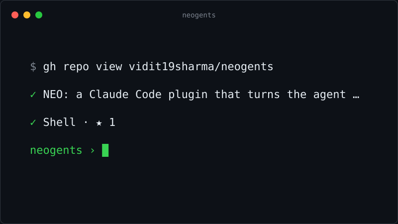
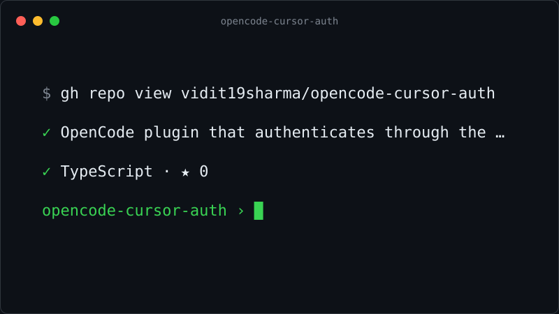
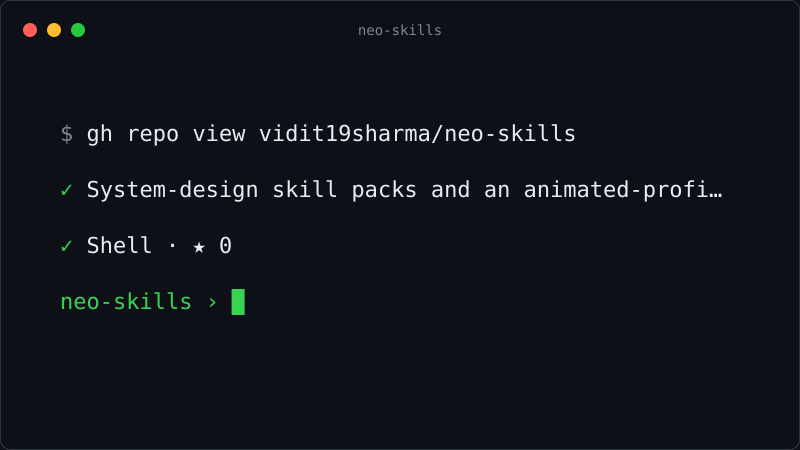
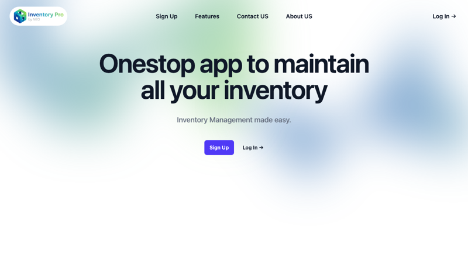
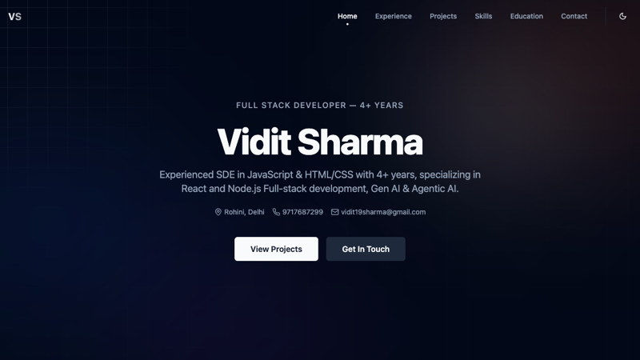
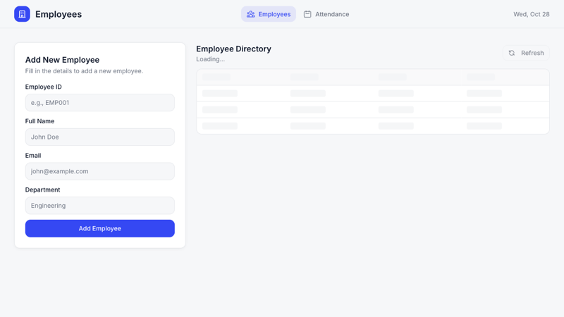

<picture><source media="(prefers-color-scheme: dark)" srcset="assets/hero.svg"><source media="(prefers-color-scheme: light)" srcset="assets/hero-light.svg"></picture>

&nbsp;
&nbsp;
&nbsp;

<table><tr>
<td width="300" valign="top"><picture><source media="(prefers-color-scheme: dark)" srcset="assets/ascii-portrait.svg"><source media="(prefers-color-scheme: light)" srcset="assets/ascii-portrait-light.svg"></picture></td>
<td valign="top">
<h3>👾 About</h3>
<ul>
<li>🔭 Building <b>neogents</b> — NEO: a Claude Code plugin that turns the agent into an orchestrator with a persistent second brain</li>
<li>🧩 Also shipping <b>opencode-cursor-auth</b> and <b>neo-skills</b></li>
<li>🌱 Building agent tooling for Claude Code &amp; OpenCode · TypeScript · Delhi</li>
<li>💬 Ask me about TypeScript, Node.js, React</li>
<li>📍 Delhi, IN · <a href="https://viditsharma.online">viditsharma.online</a></li>
<li>⌨️ Try the interactive terminal → <a href="https://vidit19sharma.github.io">vidit19sharma.github.io</a></li>
</ul>
</td>
</tr></table>

<table><tr>
<td valign="top"><picture><source media="(prefers-color-scheme: dark)" srcset="assets/neofetch.svg"><source media="(prefers-color-scheme: light)" srcset="assets/neofetch-light.svg"></picture></td>
<td valign="top"><picture><source media="(prefers-color-scheme: dark)" srcset="assets/heatmap-dark.svg"><source media="(prefers-color-scheme: light)" srcset="assets/heatmap-light.svg"></picture></td>
</tr></table>

<h3>🚀 Projects</h3>
<table>
<tr>
<td width="50%" valign="top">
 
<b><a href="https://github.com/vidit19sharma/neogents">neogents</a></b> &nbsp;⭐ 1 
NEO: a Claude Code plugin that turns the agent into an orchestrator with a persistent second brain 
<code>TypeScript</code> <code>Claude Code</code> <code>Memory</code> 
<a href="https://github.com/vidit19sharma/neogents">Source</a>
</td>
<td width="50%" valign="top">
 
<b><a href="https://github.com/vidit19sharma/opencode-cursor-auth">opencode-cursor-auth</a></b> &nbsp;⭐ 0 
OpenCode plugin that authenticates through the Cursor SDK so you can reuse your Cursor subscription 
<code>TypeScript</code> <code>OpenCode</code> <code>Cursor SDK</code> 
<a href="https://github.com/vidit19sharma/opencode-cursor-auth">Source</a>
</td>
</tr>
<tr>
<td width="50%" valign="top">
 
<b><a href="https://github.com/vidit19sharma/neo-skills">neo-skills</a></b> &nbsp;⭐ 0 
System-design skill packs and an animated-profile builder for Claude Code and OpenCode agents 
<code>Shell</code> <code>Claude Code</code> <code>OpenCode</code> 
<a href="https://github.com/vidit19sharma/neo-skills">Source</a>
</td>
<td width="50%" valign="top">
 
<b><a href="https://github.com/vidit19sharma/Inventory-Management-App">Inventory-Management-App</a></b> &nbsp;⭐ 2 
Full-stack inventory tracker with auth and reporting, live on Vercel 
<code>EJS</code> <code>Node.js</code> <code>Express</code> <code>Vercel</code> 
<a href="https://inventory-management-app-phi-six.vercel.app/">Live demo</a> · <a href="https://github.com/vidit19sharma/Inventory-Management-App">Source</a>
</td>
</tr>
<tr>
<td width="50%" valign="top">
 
<b><a href="https://github.com/vidit19sharma/Dev-Portfolio">Dev-Portfolio</a></b> &nbsp;⭐ 2 
Personal portfolio site powering viditsharma.online 
<code>TypeScript</code> <code>React</code> <code>Vercel</code> 
<a href="https://viditsharma.online">Live demo</a> · <a href="https://github.com/vidit19sharma/Dev-Portfolio">Source</a>
</td>
<td width="50%" valign="top">
 
<b><a href="https://github.com/vidit19sharma/hrms">hrms</a></b> &nbsp;⭐ 1 
HR management system: employees, leave, payroll views 
<code>JavaScript</code> <code>React</code> 
<a href="https://github.com/vidit19sharma/hrms">Source</a>
</td>
</tr>
</table>

<h3>💻 Tech Stack</h3>

<h3>🐍 Contribution snake</h3>

<picture><source media="(prefers-color-scheme: dark)" srcset="https://raw.githubusercontent.com/vidit19sharma/vidit19sharma/output/github-contribution-grid-snake-dark.svg"><source media="(prefers-color-scheme: light)" srcset="https://raw.githubusercontent.com/vidit19sharma/vidit19sharma/output/github-contribution-grid-snake.svg"></picture>

<h3>⚡ Recent activity</h3>
<!--ACTIVITY:START-->
<ol>
<li>🗣 Commented on issue "format.sh looks for project config in the session cwd, so a mid-session cd turn…" in <a href="https://github.com/vidit19sharma/neogents">vidit19sharma/neogents</a></li>
<li>🗣 Commented on issue "brain-load.sh cuts files at the cap with no marker, and tells the session not t…" in <a href="https://github.com/vidit19sharma/neogents">vidit19sharma/neogents</a></li>
<li>🗣 Commented on issue "stop-gate.sh never fires when the session commits its own work" in <a href="https://github.com/vidit19sharma/neogents">vidit19sharma/neogents</a></li>
<li>🗣 Commented on issue "Fix silent brain loss in brain-sync.sh; scope spawn-guard to NEO projects" in <a href="https://github.com/vidit19sharma/neogents">vidit19sharma/neogents</a></li>
<li>🚀 Published release neogents 0.2.1 — hardened hooks, honest docs in <a href="https://github.com/vidit19sharma/neogents">vidit19sharma/neogents</a></li>
</ol>

Last refreshed: 2026-11-05

<!--ACTIVITY:END-->

<a href="https://viditsharma.online">viditsharma.online</a> · <a href="https://github.com/vidit19sharma?tab=repositories">all repositories</a> · <a href="https://vidit19sharma.github.io">live terminal</a> · assets refresh daily via GitHub Actions

